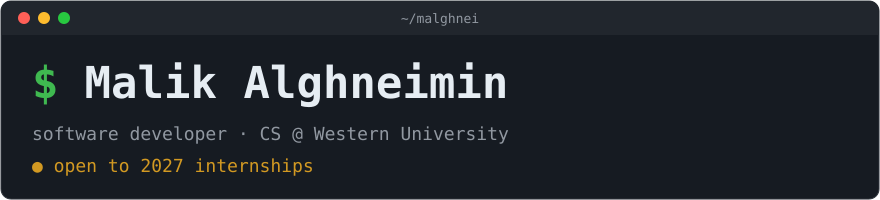

### `$` About me

Third-year CS student at Western University. I build things to fix problems I actually have. The latest is **Kata**, because I wanted to keep training Taekwondo without a dojo.

I'm most interested in software that touches the real world: computer vision, autonomous driving (I was on the Planning & Control team at WEAP), and embedded systems, and I'm getting more into cybersecurity and ML.

Away from the keyboard: badminton, Taekwondo, rock climbing.

`runs on: NixOS · Hyprland · Neovim · Kitty + Zsh · Nord`

### `$` Stats

<picture>
  <source media="(prefers-color-scheme: dark)" srcset="https://raw.githubusercontent.com/Malghnei/Malghnei/output/snake-dark.svg">
  
</picture>

### `$` Highlights

<table>
  <tr>
    <td colspan="2">
      <h4>★ <a href="https://malghnei.github.io/">Kata</a></h4>
      solo · Aug 2026 – now 
      Computer vision for martial arts: train anywhere, with or without a dojo. Mobile app to database, built solo.  
      <code>TypeScript</code> <code>Python</code> <code>React Native</code> <code>Supabase</code> <code>PostgreSQL</code>
    </td>
  </tr>
  <tr>
    <td width="50%" valign="top">
      <h4><a href="https://github.com/WE-Autopilot">WEAP</a> · Planning &amp; Control</h4>
      Autonomous-car club. Qt6 rebuild of the AP1 console (<a href="https://github.com/WE-Autopilot/console/pull/6">merged</a>), simulator drag model, Gazebo work.  
      <code>Python</code> <code>C++</code> <code>ROS 2</code>
    </td>
    <td width="50%" valign="top">
      <h4><a href="https://malghnei.github.io/">Staying Alive</a></h4>
      2D type-to-survive game, team of 5, shipped in 2–3 weeks.  
      <code>Java</code> <code>Swing</code>
    </td>
  </tr>
</table>
